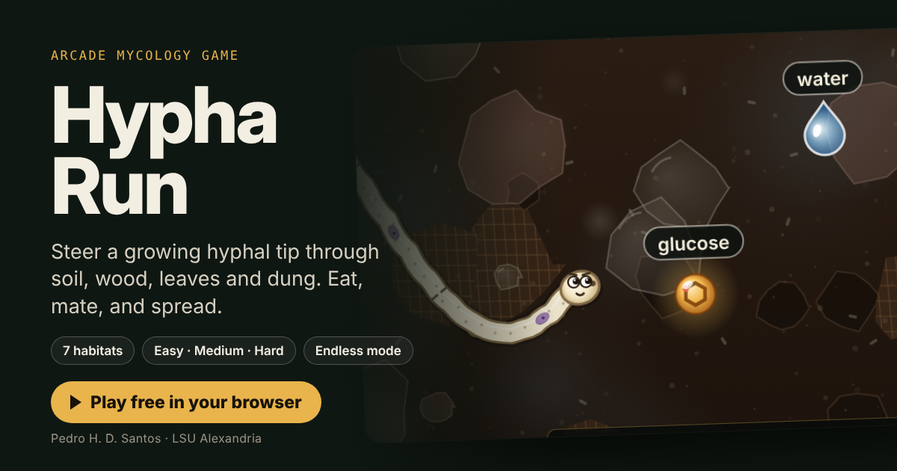

# Hypha Run

Hypha Run: an arcade mycology game. Steer a growing hyphal tip through seven habitats on Easy, Medium or Hard, or play any habitat as an endless run. The hyphae show their real nuclear condition (monokaryon, dikaryon, coenocytic), each stage ends with an animation of its life-cycle outcome, and two quiz questions check what players learned.

**Play it:** https://phdiassantos.github.io/hypha-run/

Made by Dr. Pedro H. D. Santos, Department of Biological Sciences, Louisiana State University of Alexandria, for mycology teaching (BIOL 3999). Free to use in class.

Runs in any modern browser on desktop or phone. No install and no sign-in; scores are saved only in the player's own browser.
